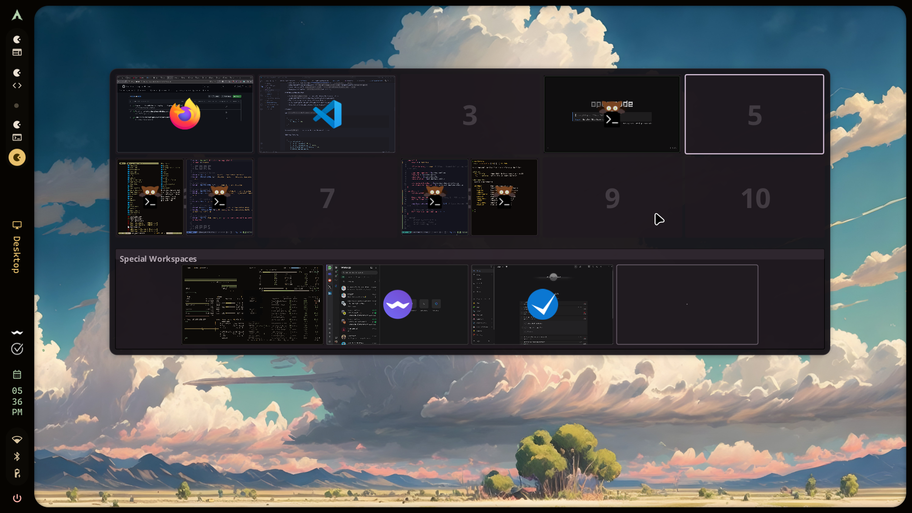

# HyprlandOverview

> **100% vibe-coded:** This project has been developed using OpenAI Codex, my locally running Qwen model, and ChatGPT (GPT-6). I direct the development and testing, but the code is AI-generated. Review it before running it on your desktop. Use at your own discretion.

A standalone [Quickshell](https://quickshell.org/) workspace overview for [Hyprland](https://hypr.land/). Includes live previews, window drag-and-drop, keyboard navigation, workspace naming, and reordering workspace contents.



## Install and run

**Requirements:** Hyprland, Quickshell (the `qs` executable), and the Qt modules shipped with Quickshell. No compiler, Python, Noctalia, or custom theme generator is required for the basic overview.

Install into the standard Quickshell configuration directory:

```sh
git clone https://github.com/Reason7322/HyprlandOverview.git ~/.config/quickshell/overview
```

Run it:

```sh
qs -c overview
```

While it is running, open, close, or toggle it using IPC:

```sh
qs ipc -c overview call overview open
qs ipc -c overview call overview close
qs ipc -c overview call overview toggle
```

No build step is necessary. **`config.json` is optional**: the overview uses internal defaults if it does not exist. To customize it, copy `config.example.json` to `config.json` inside the cloned directory.

### Optional Hyprland keyboard shortcut and autostart

On Hyprland using Lua (`~/.config/hypr/hyprland.lua`), add these inside your existing configuration, adapting to its structure:

```lua
hl.bind("CTRL + SPACE",
    hl.dsp.exec_cmd("qs ipc -c overview call overview toggle"))

hl.on("hyprland.start", function()
    hl.exec_cmd("qs -c overview")
end)
```

On older Hyprland versions using `hyprland.conf`:

```ini
bind = CTRL, SPACE, exec, qs ipc -c overview call overview toggle
exec-once = qs -c overview
```

Do not add a second autostart if another part of your desktop already starts `qs -c overview`.

## Features

- Live window previews (with an event-driven lower-resource mode available in configuration)
- Focus windows and move them between workspaces
- Workspace strip and mouse/keyboard navigation
- Saved workspace names and automatic app-derived labels
- Drag desktop tiles to **move their windows to different numeric workspace IDs**, not just cosmetically reorder tiles
- Optional Liquid Glass-style appearance and optional Hyprland blur integration
- Built-in dark palette; Noctalia is not required

## Configuration

`config.example.json` shows the available basic settings. Noctalia and wallpaper-based appearance generation are **optional**; the versioned `common/Appearance.colors.qml` contains a complete standalone palette. Replacing that file with a generated palette is an optional customization and may leave local Git changes.

Desktop names are saved at `$XDG_STATE_HOME/hyprland-overview-desktops.json` when `XDG_STATE_HOME` is set, or `~/.local/state/hyprland-overview-desktops.json` otherwise. Custom `config.json` remains local and is excluded from Git.

### Workspace reordering safety and limitations

Hyprland workspaces have numeric identities. Reordering their **contents** is not the same as changing the visual strip order. The standalone implementation uses Hyprland IPC to move windows by exact address, verifies their destination workspace IDs, and attempts restoration on failure. It does not create temporary workspaces. It does **not** edit `hyprland.lua`, `hyprland.conf`, or restart/reload Hyprland.

Because window rules and monitor placement can conflict with renumbering, the overview currently **refuses a reorder** when it detects affected pinned workspace rules, complex window states, or a cross-monitor permutation. Dragging individual windows and naming workspaces remain separate functions. Reordering does not migrate permanent window rules: edit those intentionally if you want changed assignments to survive future application launches.

The legacy Python-based rule-rewriting helper remains in the source tree for historical reference but is **not invoked by the standalone runtime**. Python and `luac` are not required to launch this version.

## Verification status

Eight Node.js model tests pass. A separate test instance launched successfully on Hyprland 0.57.0 / Quickshell 0.3.2, rendered workspace tiles and live previews, and responded to IPC open/close. With the owner's authorization, a controlled QML reordering test swapped actual windows between workspaces 10 and 11, verified the window positions and persisted name mapping, and restored the windows afterward. A separately injected partial-move failure triggered verified QML recovery. Both tests used isolated XDG state/config/cache directories; the owner's installed overview was not replaced. **Actual mouse drag interaction, other Hyprland/Quickshell versions, and cross-machine compatibility remain unverified.** Recovery cannot be guaranteed if Quickshell or the compositor is terminated mid-move.

See `PROJECT_STATUS.md` for the exact validation status and known limitations.

## Provenance and credits

The earlier owner-deployed source was recovered from Qwen commit `b3a2ceb3c5afdeadd179297c1f481d564d4362d2` (October 14, 2026). The archived source comparison excluded machine-generated files. This portability branch changes that code; the historical source-parity claim is **not** a test of this new branch.

Original overview concept and extracted component credited to [end-4/illogical-impulse](https://github.com/end-4/dots-hyprland), as documented in the upstream README. This repository carries the GNU GPL v3 license in `LICENSE`.

Personal project. Contributions and improvements are welcome.
